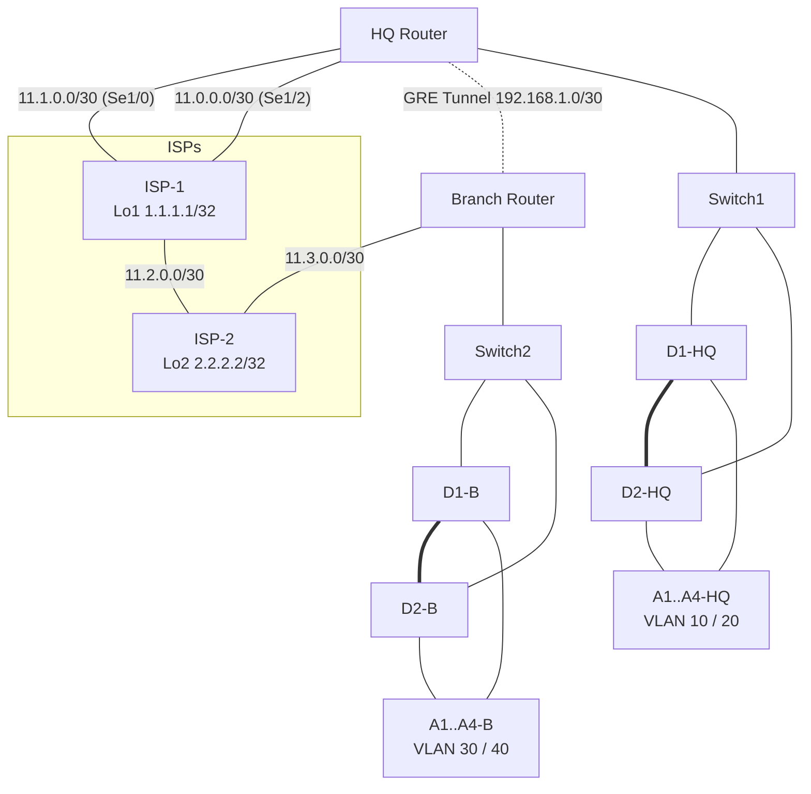

# Enterprise Network Lab: HQ + Branch over Dual ISPs (CCNA, GNS3)

A two-site enterprise network built in GNS3 as CCNA practice. It uses a hierarchical **Access / Distribution** design with redundancy at every layer: dual uplinks, first-hop redundancy, dual WAN links, and a GRE tunnel between the sites running OSPF.

## Topology



> Tip: add a screenshot of your GNS3 canvas here, e.g. ``.

## Features implemented

| Area | What was configured |
|---|---|
| **WAN routing** | OSPF process 1 across ISP-1 / ISP-2 (loopbacks advertised, passive customer-facing interfaces) |
| **Inter-site connectivity** | GRE tunnel HQ <-> Branch (`Tunnel1`, 192.168.1.0/30) with OSPF process 2 running over it |
| **WAN redundancy (HQ)** | Two serial links to ISP-1, floating static default route (`ip route 0.0.0.0 0.0.0.0 Serial1/2 2`) |
| **NAT** | PAT (overload) on HQ using route-maps per WAN link, and on Branch toward ISP-2 |
| **Default route propagation** | `default-information originate` on Branch |
| **LAN routing** | OSPF process 2 on routers and distribution switches (routed uplinks + SVIs) |
| **First-hop redundancy** | **HSRP** at HQ (VLAN 10 / 20), **VRRP** at Branch (VLAN 30 / 40); active roles split between D1 and D2 for load balancing |
| **Link aggregation** | EtherChannel between distribution switches: **PAgP** (`desirable`) at HQ, **LACP** (`active`) at Branch |
| **Spanning tree** | Rapid-PVST on all switches |
| **VLAN hygiene** | Trunks restricted to required VLANs, `switchport nonegotiate`, dedicated native VLAN 999 |
| **DHCP** | Pools with excluded ranges; DHCP relay (`ip helper-address`) at Branch |
| **Layer 2 security** | DHCP Snooping, Dynamic ARP Inspection, Port Security, DHCP rate limiting on access ports |

## IP addressing plan

### WAN / transit

| Link | Subnet | Side A | Side B |
|---|---|---|---|
| HQ <-> ISP-1 (primary) | 11.1.0.0/30 | HQ Se1/0 `.2` | ISP-1 Se1/0 `.1` |
| HQ <-> ISP-1 (backup) | 11.0.0.0/30 | HQ Se1/2 `.2` | ISP-1 Se1/2 `.1` |
| ISP-1 <-> ISP-2 | 11.2.0.0/30 | ISP-1 Se1/1 `.1` | ISP-2 Se1/1 `.2` |
| Branch <-> ISP-2 | 11.3.0.0/30 | Branch Se1/0 `.2` | ISP-2 Se1/0 `.1` |
| GRE tunnel | 192.168.1.0/30 | HQ `.1` | Branch `.2` |
| Loopbacks | 1.1.1.1/32, 2.2.2.2/32 | ISP-1 | ISP-2 |

### Sites

| Segment | Subnet | Gateway / addresses |
|---|---|---|
| HQ router <-> distribution | 192.168.50.0/24 | HQ `.1`, D1-HQ `.2`, D2-HQ `.3` |
| Branch router <-> distribution | 192.168.60.0/24 | Branch `.1`, D1-B `.2`, D2-B `.3` |

### VLANs

| VLAN | Site | Department | Subnet | Virtual IP | Protocol | Active / Master |
|---|---|---|---|---|---|---|
| 10 | HQ | IT | 192.168.10.0/24 | `.254` | HSRP | D1-HQ (priority 105) |
| 20 | HQ | Servers | 192.168.20.0/24 | `.254` | HSRP | D2-HQ (priority 105) |
| 30 | Branch | HR | 192.168.30.0/24 | `.254` | VRRP | D1-B (priority 105) |
| 40 | Branch | Management | 192.168.40.0/24 | `.254` | VRRP | D2-B (priority 105) |

DHCP: HQ pools are served by D1-HQ; Branch pools are served by the Branch router via relay. The first 20 addresses of each pool are excluded.

## Repository layout

```
.
├── README.md
├── configs/
│   ├── routers/            # HQ, Branch, ISP-1, ISP-2
│   ├── hq-switches/        # D1-HQ, D2-HQ, A1..A4-HQ
│   └── branch-switches/    # D1-B, D2-B, A1..A4-B
└── gns3-project/
    └── CCNA_enterprise_lab.gns3
```

## Tools and images

- GNS3 2.2.x
- Routers: Cisco 7200 (`c7200-adventerprisek9-mz.152-4.S6`) on Dynamips
- Switches: Cisco IOU L2/L3 images
- End hosts: VPCS

> Cisco images are not included in this repository.

## Verification commands

```
show ip ospf neighbor
show ip route ospf
show standby brief          ! HQ distribution (HSRP)
show vrrp brief             ! Branch distribution (VRRP)
show etherchannel summary
show spanning-tree summary
show ip dhcp snooping binding
show ip arp inspection
show ip nat translations
show interfaces tunnel 1
```

Failover tests worth running: shut `Serial1/0` on HQ and confirm traffic moves to `Serial1/2`; shut a distribution uplink and confirm the access switch keeps connectivity.

## Possible next steps

- Add SSH with local users or AAA, and `enable secret` on all devices
- Add ACLs between VLANs (for example, restrict HR from the Servers VLAN)
- Replace static default routes with BGP toward the ISPs
- IPv6 dual stack

## Author

**[Your Name]** | [LinkedIn](https://www.linkedin.com/in/your-profile) | CCNA candidate
